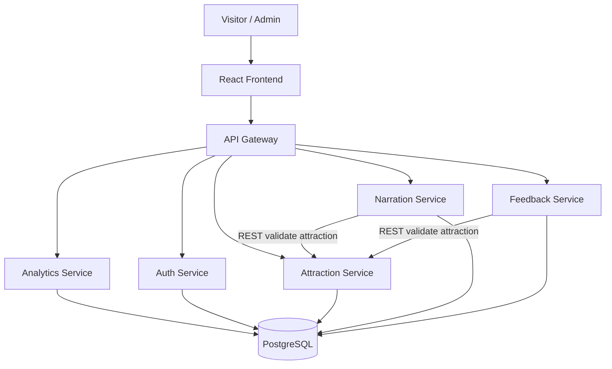

# Dinh Doc Lap Audio Guide

MVP chạy bằng Docker Compose: React/Vite, API Gateway, 5 backend service nghiệp vụ (Auth, Attraction, Narration, Feedback, Analytics), PostgreSQL, seed dữ liệu, test cơ bản và GitHub Actions CI/CD mẫu.

## Chạy local

1. Cài Docker Desktop và mở Docker.
2. Sao chép `.env.example` thành `.env`; đặt `POSTGRES_PASSWORD` và `JWT_SECRET` thành giá trị ngẫu nhiên riêng (JWT tối thiểu 32 ký tự; mật khẩu DB nên dùng ký tự URL-safe). Đặt `ADMIN_EMAIL` và `ADMIN_PASSWORD` (tối thiểu 12 ký tự) để tạo tài khoản quản trị ban đầu; nếu bỏ trống thì không tạo admin.
3. Chạy `docker compose up --build` tại thư mục dự án.
4. Mở frontend tại http://localhost:8080; API health tại http://localhost:8080/api/v1/health.
Compose tự khởi tạo schema và dữ liệu mẫu khi PostgreSQL tạo volume lần đầu; dịch vụ `analytics-migration` áp dụng migration để hỗ trợ cả volume cũ. Khi cập nhật ZIP có thay đổi migration, chạy `docker compose up --build --force-recreate -d` để chắc chắn container migration chạy lại; lệnh này không xóa volume dữ liệu. Nếu cần reset toàn bộ dữ liệu demo: `docker compose down -v` rồi `docker compose up --build`.

Nếu đã chạy phiên bản cũ, volume PostgreSQL hiện hữu có thể vẫn chứa tài khoản demo được tạo trước đây; hãy đổi hoặc xóa tài khoản đó sau khi sao lưu DB. Thay đổi này không tự sửa thông tin đăng nhập trong volume cũ.

## Sử dụng QR và dashboard thống kê

- Đăng nhập ở mục **Quản trị** → **Mã QR**. Nếu giao diện được mở tại `localhost`, hãy chạy `ipconfig` trên máy tính, tìm IPv4 Address của card Wi-Fi/Ethernet, rồi nhập `http://IP-IPv4:8080` (ví dụ `http://192.168.1.20:8080`) trước khi tải QR. Giao diện cảnh báo nếu URL còn trỏ tới localhost.
- Chọn **Trang chủ** để tạo QR mở trang chính của ứng dụng hoặc chọn **Trang địa điểm** để tạo QR mở thẳng một địa điểm cụ thể. Cả hai loại mã đều gắn `source=qr` để ghi nhận lượt quét khi khách mở liên kết.
- Để thử quét bằng nhiều điện thoại: tất cả thiết bị phải cùng Wi-Fi với máy tính chạy Docker; máy tính phải bật và ứng dụng đang chạy. Quét bằng camera mặc định của điện thoại và mở liên kết. Nếu không truy cập được, kiểm tra Windows Defender Firewall cho phép truy cập mạng Private vào Docker/port 8080. Không cần và không nên mở port trên router Internet chỉ để thử LAN.
- Để khách sử dụng ở địa điểm tham quan qua mạng di động hoặc Wi-Fi khác, cần triển khai ứng dụng lên máy chủ/domain công khai có HTTPS, sau đó nhập domain đó khi tạo QR. Mã QR không thể làm địa chỉ `localhost` hay IP nội bộ truy cập được từ Internet.
- Khách không cần tạo tài khoản để xem/nghe. Hệ thống ghi nhận sự kiện `app_opened`, `qr_scan` (khi link QR được mở), `place_opened`, `narration_started`, `narration_completed` và `visit_marked`. Dashboard tự đọc lại số liệu từ PostgreSQL mỗi 5 giây khi đang mở. Khi nhiều điện thoại quét cùng mã, mỗi trình duyệt có UUID ẩn danh riêng và mỗi sự kiện được ghi thành dòng riêng.
- “Khách ẩn danh” là trình duyệt/thiết bị được nhận diện bằng UUID trong localStorage, không phải danh tính thật hay số người được xác minh. Nếu đổi thiết bị/trình duyệt hoặc xóa storage, một người có thể được tính là khách mới. Lượt QR được đếm khi liên kết gắn `source=qr` được mở; việc chỉ mở camera xem QR mà không bấm vào liên kết không thể được web app phát hiện. “Đã tham quan” là thao tác khách chủ động bấm nút đánh dấu. Container `analytics-migration` thoát với mã 0 sau khi migration chạy thành công là bình thường.

## Các thành phần

- `frontend`: React, Vite, React Router, Leaflet, Web Speech API; khách có thể xem địa điểm, nghe nội dung bằng trình đọc của trình duyệt, bật GPS hoặc chọn thủ công.
- `api-gateway`: điểm vào duy nhất cho frontend, proxy theo nhóm API và kiểm tra health.
- `auth-service`: đăng nhập, JWT, bcrypt.
- `attraction-service`: địa điểm và lộ trình; API quản trị hỗ trợ tạo/sửa/ẩn địa điểm và tạo/sắp xếp các điểm trong lộ trình.
- `narration-service`: nội dung song ngữ và trạng thái công bố; gọi Attraction Service để xác minh điểm.
- `feedback-service`: tiếp nhận phản hồi; gọi Attraction Service để xác minh điểm.
- `analytics-service`: ghi nhận sự kiện ẩn danh (quét QR, mở địa điểm, đánh dấu tham quan, bắt đầu/hoàn tất nghe) và cung cấp tổng hợp cho dashboard quản trị.
- `database/init.sql`: schema + seed. `database/migrations/001_narration_publication.sql` bổ sung cột công bố thuyết minh cho database cũ; `002_visitor_analytics.sql` tạo bảng sự kiện thống kê. PostgreSQL dùng chung trong demo, các bảng tách theo nghiệp vụ.

## API chính

- `GET /api/v1/health`
- `POST /api/v1/auth/login` `{ "email":"<ADMIN_EMAIL>", "password":"<ADMIN_PASSWORD>" }` (giá trị cấu hình trong `.env`)
- `GET /api/v1/attractions`, `GET /api/v1/attractions/:id`, `GET /api/v1/tours`
- `GET /api/v1/narrations/:attractionId/:language` (`vi`, `en`, `zh` hoặc `th`)
- `POST /api/v1/analytics/events` ghi sự kiện tham quan/thuyết minh không chứa danh tính thật.
- `GET /api/v1/analytics/summary?days=30` tổng hợp số liệu (JWT admin; `days` từ 1 đến 90).
- `POST /api/v1/feedback` `{ "attractionId":"independence-palace", "rating":5, "message":"...", "type":"review" }`
- `GET /api/v1/feedback` (JWT admin); `PATCH /api/v1/feedback/:id/status` (JWT admin)
- `GET /api/v1/attractions/admin/all` (JWT admin); `POST /api/v1/attractions`, `PUT /api/v1/attractions/:id`, `DELETE /api/v1/attractions/:id` (ẩn mềm, JWT admin)
- `POST /api/v1/tours`, `PUT /api/v1/tours/:id` (JWT admin; quản lý lộ trình)
- `PUT /api/v1/narrations/:id` (JWT admin; cập nhật kịch bản vi/en/zh/th, audio URLs và trạng thái công bố)

Phản hồi API dùng JSON; admin endpoint được kiểm tra JWT và role ở service. Chi tiết thêm xem `docs/api.md`.

## Kiểm thử

Mỗi service có `npm test`; trong thư mục service chạy `npm install` trước. CI workflow chạy lint/test/build theo các package. Có test unit cho logic khoảng cách, kiểm tra dữ liệu và health route cơ bản. Cần chạy `docker compose up --build` để kiểm thử tích hợp end-to-end trong môi trường Docker.

## CI và CD

- `.github/workflows/ci.yml`: cài dependencies, chạy test/build và build image.
- `.github/workflows/cd.yml`: với tag `v*`, chạy verify lint/test/build trước; chỉ sau khi verify thành công mới build/push image lên GHCR và tùy chọn SSH deploy nếu khai báo secrets `DEPLOY_HOST`, `DEPLOY_USER`, `DEPLOY_SSH_KEY`, `DEPLOY_PATH`. Khi deploy, đặt `IMAGE_OWNER` bằng owner/repository namespace trên GHCR và `IMAGE_TAG` bằng tag phát hành trong môi trường remote.
- Không có máy chủ/Secrets thì CD không thực hiện deploy; chạy local vẫn hoạt động. Không dùng chung mật khẩu hoặc JWT secret giữa các môi trường.

## Giới hạn MVP cần biết

- Nội dung địa điểm được cung cấp là dữ liệu demo ngắn; cần biên tập/đối chiếu với nguồn chính thức của Dinh Độc Lập trước khi dùng công khai. Các URL nguồn chính thức được để trong dữ liệu.
- Thuyết minh sử dụng Web Speech API, giọng đọc phụ thuộc trình duyệt/hệ điều hành; chưa kèm file audio thu âm sẵn.
- GPS kích hoạt dùng tọa độ cấu hình demo và bán kính 80m; GPS trong nhà không đảm bảo chính xác. Chế độ chọn thủ công luôn có sẵn.
- QR code mở trang chủ hoặc từng địa điểm và dashboard thống kê sự kiện đã được bổ sung. Dữ liệu khách là mã định danh ẩn danh trong trình duyệt, không cho biết danh tính thật; nếu đổi trình duyệt/thiết bị hoặc xóa storage, một người có thể xuất hiện thành khách mới. “Đã tham quan” trong dashboard là lượt khách chủ động bấm nút đánh dấu.
- PWA/offline audio, upload tệp audio/ảnh từ giao diện, refresh token, đồng bộ tiến độ khách trên nhiều thiết bị và triển khai production đầy đủ chưa nằm trong MVP. Audio dùng Web Speech API; phần quản trị hỗ trợ lưu URL ảnh nhưng chưa có luồng upload file.
- GitHub Actions là cấu hình mẫu, chưa thể tuyên bố CI/CD đã chạy thành công trong repository thật. Chạy các lệnh kiểm thử để xác nhận trên máy của bạn.

## Sơ đồ kiến trúc

